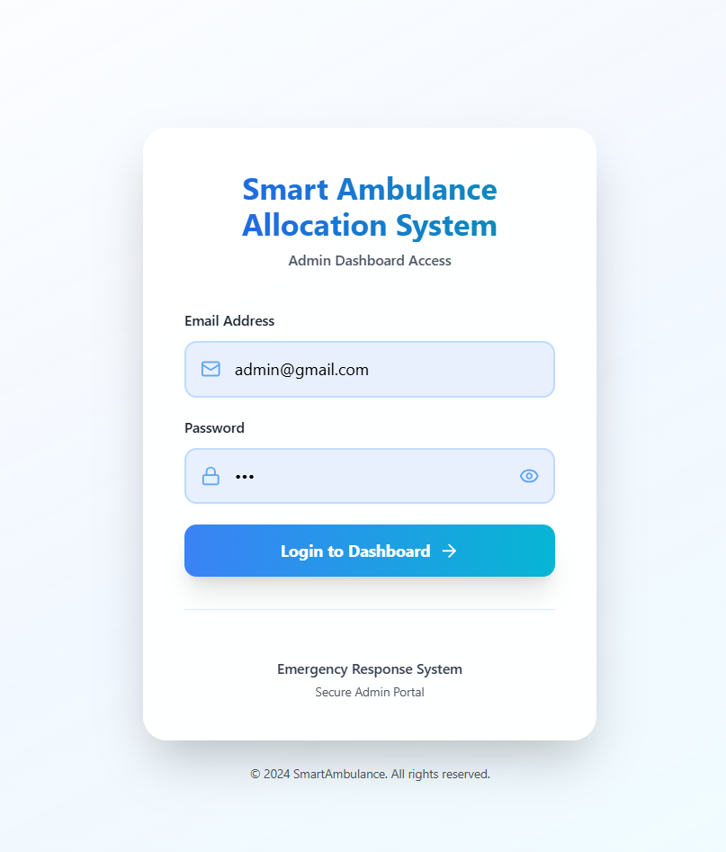
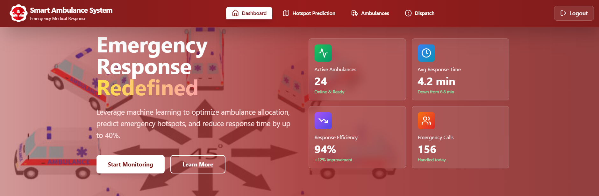
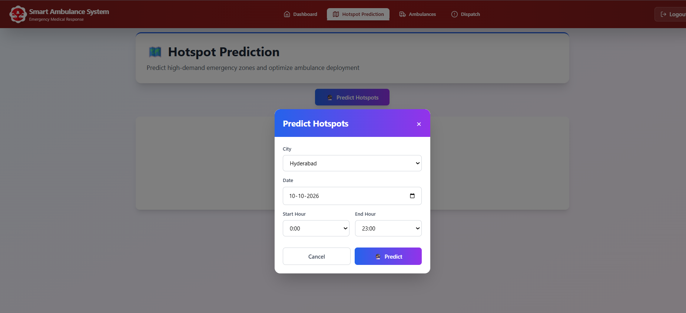
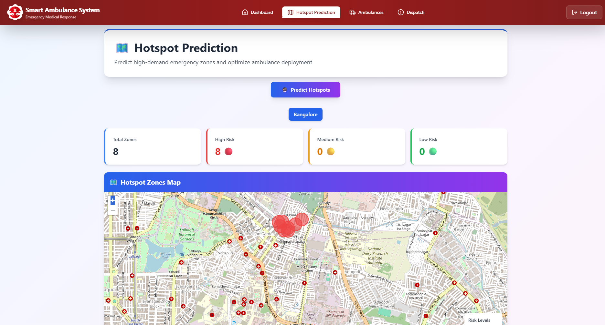
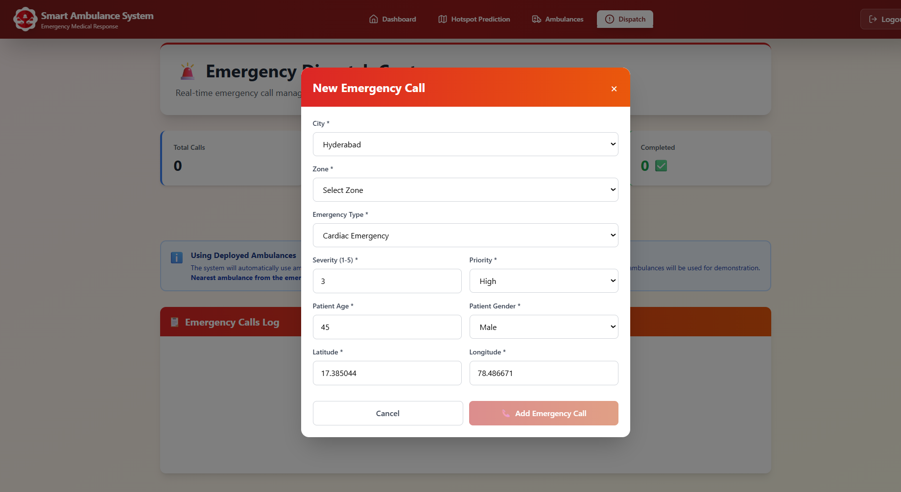
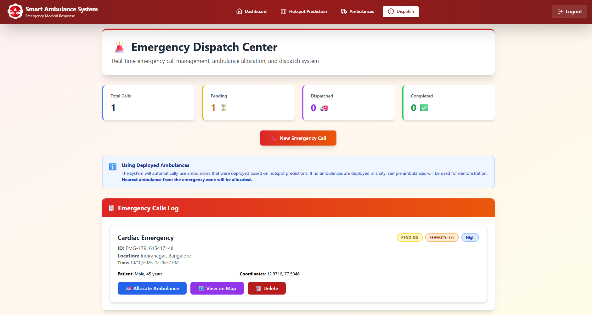
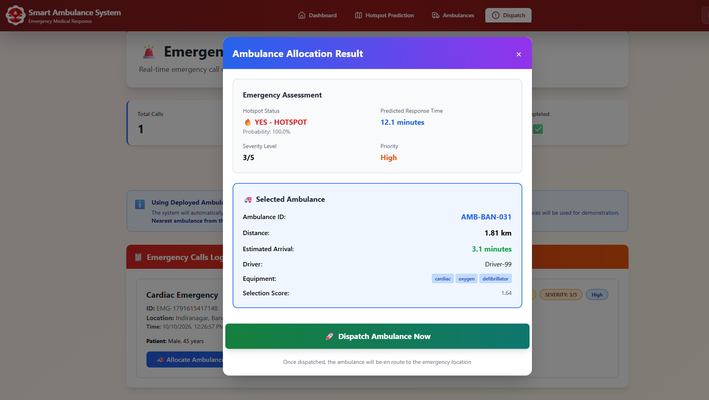
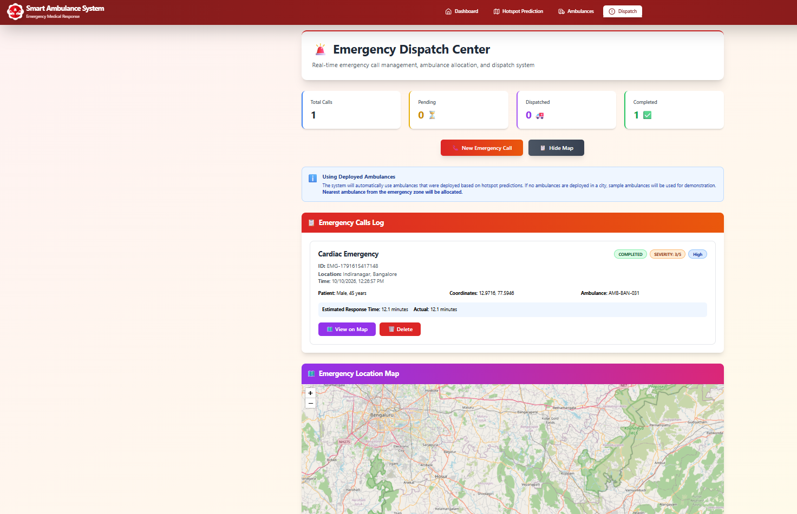

# Smart Ambulance Allocation System (Frontend)

A machine-learning-assisted dashboard for emergency services administrators. It **predicts where emergencies are likely to occur, deploys ambulances to those zones in advance, and allocates the nearest ambulance when an emergency call comes in.**

> Traditional systems park ambulances in fixed locations and react after a call. This system is **proactive**: it uses historical data to predict high-demand zones and positions ambulances before emergencies happen.

**Live demo:** https://ai-powered-emergency-response-syste.vercel.app

<!-- Add when your backend repo is public: **Backend (Flask + ML):** https://github.com/VENKATESH2269/<backend-repo> -->

## Screenshots

| Login | Dashboard |
|---|---|
|  |  |

| Hotspot prediction form | Predicted hotspot zones on map |
|---|---|
|  |  |

| New emergency call | Dispatch center |
|---|---|
|  |  |

| Ambulance allocation result | Completed call with map |
|---|---|
|  |  |

## Features

| Page | What it does |
|---|---|
| **Landing page** | Product overview with services, features and how it works |
| **Login** | Admin sign-in to the dashboard |
| **Dashboard** | Overview cards (ambulances, response time, efficiency, calls) and shortcuts to each module |
| **Hotspot Prediction** | Choose a **city** (Hyderabad, Bangalore, Chennai, Visakhapatnam, Vijayawada or all cities), a **date** and an **hour range**; the ML model returns predicted zones with a High / Medium / Low risk level, shown as a summary and on an interactive map |
| **Ambulances** | Deploy ambulances to predicted hotspot zones; view each ambulance's ID, driver, equipment, location and status; view on map; remove or clear deployments |
| **Dispatch** | Create a new emergency call (city, zone, emergency type, severity 1-5, priority, patient age and gender, coordinates), then **allocate the nearest ambulance**, view the call on the map, or delete it. The allocation result shows whether the location is a predicted hotspot (with probability), the predicted response time, and the selected ambulance with distance, ETA, equipment and selection score. Calls move through Pending, Dispatched and Completed |

## How it works

1. **Historical data** (time of day, day of week, location, population density, response time, emergency count) is collected.
2. A **supervised ML model** is trained on that data to learn high-risk areas and time patterns.
3. The admin requests a **hotspot prediction** for a city, date and time window.
4. **Ambulances are pre-positioned** in the predicted high-risk zones.
5. When an emergency call is raised, the system **allocates the nearest available ambulance** from the deployed fleet.
6. The admin tracks call status in the Dispatch Center.

<!-- Add here: which algorithm you used (e.g. Random Forest), your dataset (real or generated, number of rows) and your evaluation metric (accuracy / R2 / MAE). -->

## Tech stack

- **Frontend:** React 19, TypeScript, Vite, Tailwind CSS 4, React Router
- **Maps and charts:** Leaflet / React-Leaflet, Recharts
- **HTTP:** Axios
- **UI extras:** lucide-react, AOS (scroll animations), Formspree (contact form)
- **Backend (separate project):** Python, Flask, Flask-CORS, pandas, NumPy, scikit-learn, joblib

## Getting started

```bash
git clone https://github.com/VENKATESH2269/AI-Powered-Emergency-Response-System---Front-end.git
cd AI-Powered-Emergency-Response-System---Front-end
npm install
npm run dev
```

The app runs at http://localhost:5173. Hotspot predictions need the Flask backend to be running.

Other scripts:

```bash
npm run build     # type-check and production build
npm run lint      # run ESLint
npm run preview   # preview the production build
```

### Running the backend

```bash
python -m venv venv
venv\Scripts\activate          # Windows
pip install -r requirements.txt
python app.py
```

## Project structure

```
src/
  components/   # LandingPage, LoginPage, AdminDashboard, AdminNavbar,
                # HotspotPrediction, Ambulances, Dispatch
  App.tsx       # routes
  main.tsx      # entry point
public/         # static assets
```

## Notes

- Ambulance fleet details (drivers, equipment) and some dashboard figures are **sample data for demonstration**.
- If no ambulances are deployed for a city, the Dispatch Center falls back to sample ambulances for demo purposes.

## Author

Venkatesh
